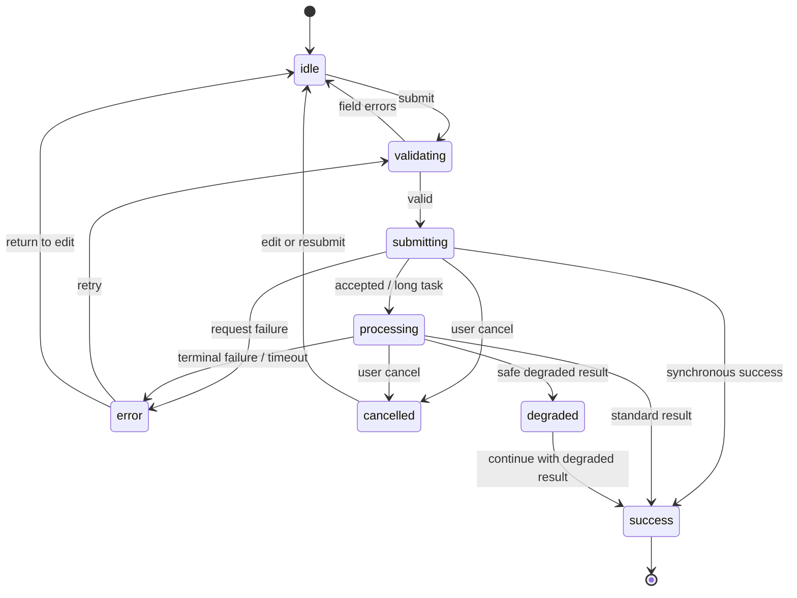

# Phase 2.5A Async State Machines v0.1

## 通用提交状态机

每个状态必须有文本标签和图标；颜色只是辅助。异步错误容器使用 `role=alert`，状态进度使用 `aria-live=polite`，破坏性或阻断性错误使用 `aria-live=assertive`。

## 创建准备包

| 状态 | UI | 允许动作 |
|---|---|---|
| idle | 可编辑表单 | 校验、离开 |
| validating | 聚焦首个错误 | 修改字段 |
| submitting | 按钮 loading 且禁用重复提交 | 取消请求 |
| processing | Stepper：画像解析→匹配→题库→保存 | 查看 Agent run、取消本地等待 |
| success | 进入摘要与题库 | 继续 |
| degraded | DegradationNotice、来源与原因 | 继续使用、查看详情、重试整个任务 |
| error | 字段级或任务级错误 | 重试、返回修改 |
| cancelled | 保留会话内输入 | 重新提交、返回修改 |

## 上传/粘贴

- validating 检查是否为空、类型与后端已冻结的大小限制；限制未冻结前不硬编码推测值。
- uploading 展示文件名、进度或不确定进度、取消按钮。
- 422 错误靠近 UploadDropzone；取消后移除未完成文件句柄但保留可重新选择提示。

## Agent run

- `pending/running` 对应 processing，显示当前 step；轮询策略待后端合同确认。
- `succeeded + execution_mode!=fallback` 对应 success。
- `succeeded + execution_mode=fallback` 对应 degraded。
- `failed` 对应 error；只使用白名单失败类别，不展示原始异常。

## 评价

- standard：ScoreCard 与 EvaluationDimensions。
- degraded：NoScoreState 文案固定为“本次无法提供可信分数”，同时展示 `source_quality`、`degradation_reasons` 和继续练习选项。
- timeout：不将未知结果解释为失败分数；保留答案草稿并允许重试。
- cancelled：不自动创建第二次请求；回到可编辑状态。

## 防重复与焦点

- 从 submitting 开始锁定对应提交控件；只在终态或显式取消后解锁。
- 进入 error 后把焦点移动到错误摘要或第一个字段错误。
- 进入 success/degraded 后把焦点移动到结果主标题。
- reduced-motion 下取消位移动画，状态变化仍通过文本与 live region 通知。

